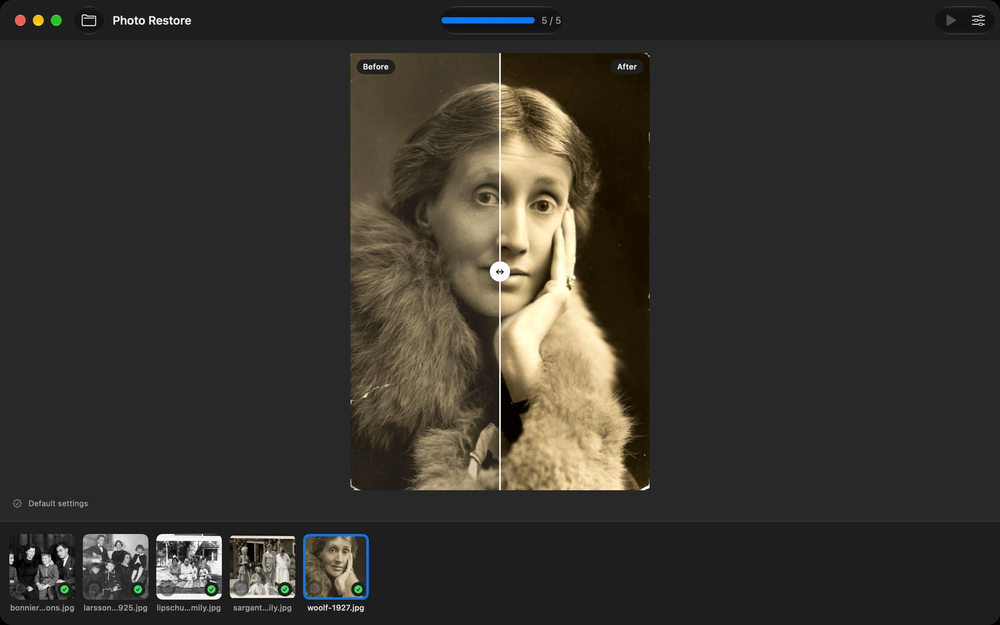
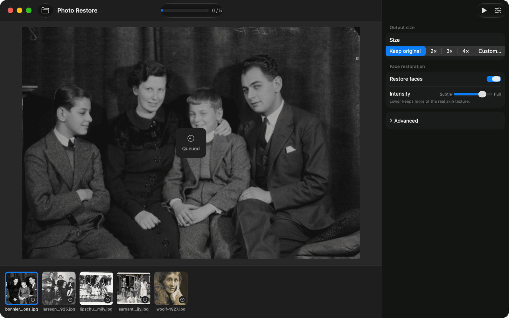
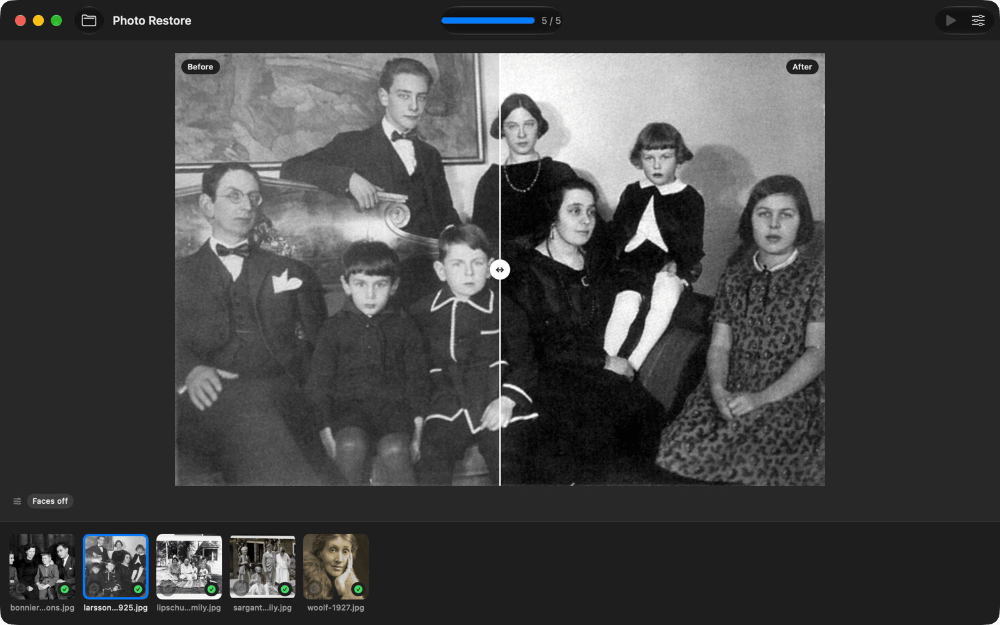

# Photo Restore

A dirt-simple, native macOS app that restores old family-photo scans — faded prints, low-res
snapshots, soft faces. Drag in a photo or a folder, optionally pick an output folder, and watch
each photo restore with a live before/after preview. Everything runs **on-device** (Apple Silicon,
Core ML) — no cloud, no accounts, no data leaves your Mac.

It's a native Swift reimplementation of the [`photo-restore`](../photo-restore) Python CLI, using
the same models converted to Core ML.



## What it does

- **Auto-contrast** faded scans (luminance-preserving — never shifts color, never colorizes).
- **Upscale** with Real-ESRGAN x4plus (optional 2×/3×/4× or fit-to-size), tiled with feathered seams.
- **Restore faces** with GFPGAN, aligned via Apple Vision, composited back with a parsing mask so
  only the face is touched. Color-match (B&W stays gray), texture-preserving blend, matched grain.
- **Batch** 100+ images with live progress, a filmstrip of every image, and a before/after slider.

## Screenshots

| Queue a folder, adjust settings | Restore without face enhancement |
| --- | --- |
|  |  |

> **Known limitation: small faces.** Face restoration works well on faces that fill a good part of
> the frame, like the portrait above. On small faces, such as a group photo with several people,
> it currently produces flat, gray, featureless faces. For group shots, turn **Restore faces** off
> in the settings panel (as in the right-hand screenshot): you still get the contrast fix and
> upscaling. Always check the before/after slider.

Sample photos are public domain or have no known copyright restrictions, via Wikimedia Commons:
Virginia Woolf (1927), the Yngve Larsson family (1925), Tor Bonnier's sons (Jan de Meyere), the
Lipschultz family (Jewish Historical Society of the Upper Midwest), and Mary Sargant Florence and
family.

## Architecture

- **`PhotoRestore/`** — the SwiftUI app (drag-drop, filmstrip, before/after viewer, settings).
- **`RestoreEngine/`** — an internal, SwiftUI-free Swift package: the whole pipeline (image I/O,
  contrast, tiled upscale, Vision alignment, face restore + paste-back), the Core ML model store,
  and the serial `InferenceEngine` + `BatchCoordinator`. Fully unit-tested (`swift test`).
- **`tools/models/`** — Python tooling to download + validate the pre-converted Core ML models
  (see `tools/models/VALIDATION.md`).

## Build & run

Requires Xcode 16+ and [XcodeGen](https://github.com/yonyz/XcodeGen) (`brew install xcodegen`).

```sh
xcodegen generate
open PhotoRestore.xcodeproj      # or: xcodebuild -scheme PhotoRestore build
cd RestoreEngine && swift test   # run the engine test suite
```

### Models

On first launch the app offers to download its ~294 MB of Core ML models from this repo's
[`models-v2` release](https://github.com/alecf/photo-restore-mac/releases/tag/models-v2)
(`ModelRegistry.baseURL`; see `tools/models/HOSTING.md`). For offline use, **Install from Folder…**
takes a folder containing `RealESRGAN4x.mlmodel`, `GFPGAN-ANE.mlmodel` and `FaceParsing.mlmodel`.
Each file is SHA-256-verified, compiled to `.mlmodelc`, and cached in Application Support.

`GFPGAN-ANE.mlmodel` is the upstream GFPGAN Core ML model rewritten by
`tools/models/rewrite_gfpgan_ane.py` so it runs on the Neural Engine (~45 ms per face, about 20×
faster than the GPU). The original build overflows 16-bit floats there and outputs a flat square.
The `Models` GitHub Actions workflow builds and publishes these files; see `tools/models/HOSTING.md`.

## Distribution

`scripts/dmg-local.sh` builds an ad-hoc `.dmg` for local testing. `scripts/release.sh` builds a
Developer-ID-signed, notarized, stapled `.dmg` — see `RELEASE.md` for the (Apple-account)
prerequisites.

## License

App code: **MIT** (see `LICENSE`). The restoration models carry their upstream licenses —
Real-ESRGAN (BSD-3), GFPGAN (Apache-2), BiSeNet face-parsing (MIT). (CodeFormer, a non-commercial
"balanced" face model, is a deferred future option.)
